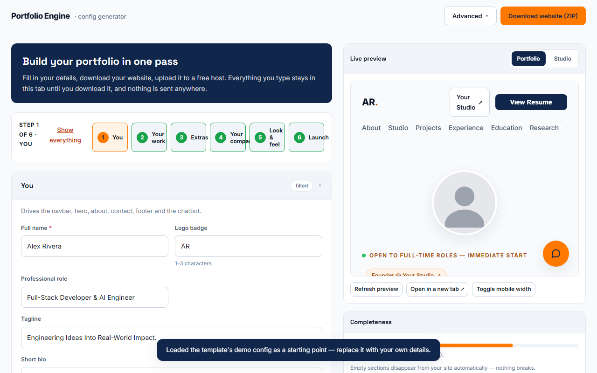
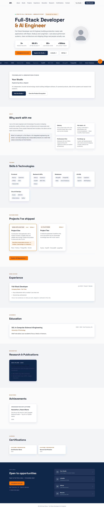
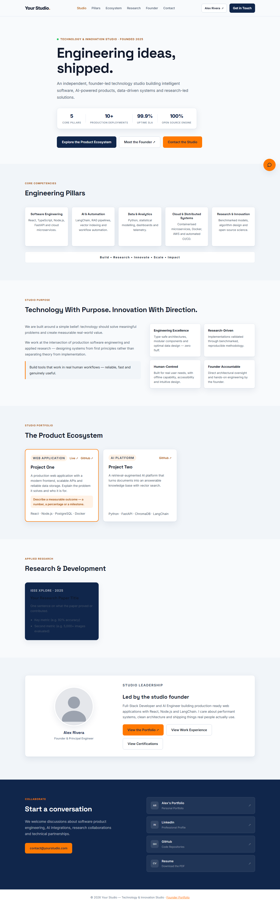

<div align="center">

# ABMVSC Portfolio Engine

### Free, open-source portfolio website generator

Fill in your details, download your site, go live.<br>
No code, no account, nothing uploaded.

[](https://github.com/Balama2520/abmvsc-portfolio-engine/actions/workflows/validate.yml)
[](LICENSE)
[](package.json)
[](CONTRIBUTING.md)

[**Create your portfolio**](https://abmvsc-portfolio-engine.netlify.app/setup.html) &nbsp;|&nbsp;
[Sample portfolio](https://abmvsc-portfolio-engine.netlify.app/) &nbsp;|&nbsp;
[Sample company page](https://abmvsc-portfolio-engine.netlify.app/studio.html) &nbsp;|&nbsp;
[Report a bug](https://github.com/Balama2520/abmvsc-portfolio-engine/issues/new/choose) &nbsp;|&nbsp;
[Discussions](https://github.com/Balama2520/abmvsc-portfolio-engine/discussions)



**Released for Diwali 2026. Free to use, no account, nothing uploaded.**

</div>

---

## What is it?

A portfolio website generator that runs entirely in your browser. You answer plain questions, upload a photo and a resume, and download a complete website as a ZIP file that you own. Put the folder on any free static host and you are live.

It makes a personal portfolio and, if you want one, a company or studio page.

## Why?

Students and freshers are told to have a portfolio, then offered three routes: a paid site builder that keeps your details on its servers, a template that needs a framework and a build toolchain, or a blank page.

This is a fourth route. It is free, it needs no account, and your details never leave your device. It also pushes you towards what reviewers look for: projects written as short case studies with live links, a clear bio, and an easy way to contact you.

It cannot make weak projects strong. If you need a visual editor, many designs, a blog, forms or hosting handled for you, a hosted builder is a better fit.

## How does it work?

1. **Fill in your details** in the generator. Six short steps, with a live preview.
2. **Download your website** as a ZIP. It is built in your browser.
3. **Put it online** on a free host. The ZIP includes the steps.

## How to use it

**1. Gather what you have.** You can skip anything and add it later.

| Item | Notes |
|---|---|
| Photo | JPG, PNG or WebP. Large phone photos are resized for you. |
| Resume | PDF, up to 5 MB |
| Two to five projects | For each: the problem, what you built, tools, the result, and a link |
| Contact details | Email matters most. Add LinkedIn or GitHub if you have them. |
| Short bio | Two or three sentences: what you do and what you are looking for |

**2. Open the [generator](https://abmvsc-portfolio-engine.netlify.app/setup.html)** and answer the steps: You, Your work, Extras, Your company, Look and feel, Launch. The preview updates as you type, and your draft is saved on your device.

**3. Check the recruiter checklist** and fix anything it flags.

**4. Click Download website (ZIP).** Unzip it and open `index.html` to check your site.

**5. Put the folder online.** Any static host works:

| Host | Steps |
|---|---|
| **Netlify** | Open [app.netlify.com/drop](https://app.netlify.com/drop) and drag the folder in. An account is optional. |
| **Vercel** | Deploy the folder. `vercel.json` is included. No build command. |
| **Cloudflare Pages** | Create a project, choose Direct Upload, and drop the folder in. |
| **GitHub Pages** | Push the folder to a repository, then Settings, Pages, deploy from the `main` branch root. |

**6. Share it.** Add the link to your resume, LinkedIn, GitHub profile and email signature. Paste it into a chat and check the preview card.

**To update it later,** open the generator, choose **Advanced**, then **Import**, pick the `config.js` from your ZIP, change what you need, download again and replace the files on your host.

Filling in the form works on a phone. Putting the site online is easier on a computer.

For a custom domain, enter it in **Your website address** before downloading, so canonical links, the sitemap and social images use it.

## Features

| | |
|---|---|
| **Portfolio and company page** | A personal site and an optional studio page, linked together |
| **Case-study project cards** | Problem, what you built, tools, result and link |
| **Recruiter checklist** | Shows what is missing while you type |
| **Photo and resume handling** | Photos are cropped, resized and compressed in the browser. Your PDF goes into the ZIP. |
| **Three themes** | Light, dark and minimal, with your own accent colour |
| **Share-ready pages** | Title, description, social card, structured data, favicons and a generated preview image are written into the pages, so link previews work without JavaScript |
| **Print and contact** | A clean one-page CV with Ctrl+P, and a **Save contact** button |
| **Deploy anywhere static** | Host files for Netlify, Vercel, Cloudflare Pages and GitHub Pages are in the ZIP |

A finished site carries no ABMVSC text, links or images unless you tick the optional footer credit.

## Screenshots

| Generator | Portfolio | Company page |
|---|---|---|
|  |  |  |

The sample pages use placeholder content. Replace it with your own details.

## Privacy and security

- **Nothing is uploaded.** There is no server, no account, no analytics and no cookies set by this project. Your draft stays in your browser's local storage.
- **No third-party requests.** Fonts are served from the site itself, and the tests fail if any request leaves the origin.
- **Importing never runs code.** `config.js` is strict JSON read with `JSON.parse`.
- **Links are filtered.** Only `http`, `https`, `mailto` and `tel` are accepted for links, and `javascript:` and similar schemes are blocked in the generator, the ZIP builder and at runtime.
- **Hostile input is tested.** A permanent test puts malicious strings into every text and link field, builds a site, opens it in a browser and checks that nothing executes.
- **The chat assistant** on a finished site is a keyword matcher that answers from your own details. It is not an AI service and makes no network requests.

Full note: [docs/PRIVACY.md](docs/PRIVACY.md). To report a vulnerability, use GitHub's private vulnerability reporting. See [SECURITY.md](SECURITY.md).

## FAQ

**Is my data uploaded?** No. The generator is a static page and does all its work in your browser.

**Is the chat assistant AI?** No. It matches keywords against the details you entered.

**Can I add a contact form?** The site is static, so there is no server to receive one. It offers an email link and a downloadable contact card.

**Why does GitHub Pages show my old version?** GitHub Pages ignores header files. The config file is requested with a content hash to help, but if you still see old content, clear the browser cache once.

**Can I show or hide the ABMVSC credit?** It is off by default. The generator has a checkbox.

**Which browsers and devices work?** Automated tests run the full flow in Chromium, Firefox and WebKit. Please open an issue if something breaks on your device.

## Known limits

- Mobile performance scores are lower than they should be for a static site. This is the next engineering task.
- No server, so no forms, accounts, analytics or hosting.
- Three themes and one accent colour. English only.
- Real-device testing is incomplete, including iPhone Safari.
- PDF preview depends on the visitor's browser. A download link is always available.
- A young project. Expect rough edges, and please report them.

## For developers

<details>
<summary>Run it locally, data format and tests</summary>

```bash
git clone https://github.com/Balama2520/abmvsc-portfolio-engine.git
cd abmvsc-portfolio-engine
npx serve .
# open http://localhost:3000/setup.html
```

The live preview needs a local server rather than a `file://` address.

**One data file.** `config.js` assigns strict JSON to `window.PORTFOLIO_CONFIG`: quoted keys, no comments, no trailing commas. Every section is optional. A blank field hides its element and an empty array hides its block. The 15 sections are `personal`, `seo`, `hero`, `about`, `skills`, `projects`, `experience`, `education`, `research`, `achievements`, `certifications`, `company`, `contact`, `chatbot` and `theme`.

```js
window.PORTFOLIO_CONFIG = {
  "personal": { "name": "Your Name", "role": "Your role" },
  "projects": []
};
```

**How pages render.** `script.js` fills elements marked with `data-bind`, `data-list`, `data-list-host`, `data-section` and `data-page`. At download time the generator also writes the title, description, social tags, structured data and hero text into the static HTML. See [CONTRIBUTING.md](CONTRIBUTING.md) for the full attribute contract.

**Tests.** Requires Node 22 or later.

```bash
npm ci
npx playwright install --with-deps chromium firefox webkit
npm test
```

The suite covers the import parser, link allow-list, hostile input, ZIP contents and links, rendering with and without JavaScript, layout at phone and desktop widths, keyboard use, axe accessibility checks and Lighthouse category checks. The guardrail tests fail the build if anyone adds a runtime dependency, a build step, third-party JavaScript or a third-party request.

</details>

## Roadmap

- [x] Generator with live preview, themes and recruiter checklist
- [x] Complete site as a ZIP, with host files for four platforms
- [x] Strict, non-executing import and a link allow-list
- [x] Automated accessibility, keyboard and layout checks
- [ ] Real-device test results published in the repository
- [ ] Faster mobile performance
- [ ] Named profiles for different roles
- [ ] Optional GitHub repository import (opt-in, off by default)
- [ ] JSON Resume import and export
- [ ] More layouts and more interface languages

Ideas and votes are welcome in [Discussions](https://github.com/Balama2520/abmvsc-portfolio-engine/discussions). See also [ROADMAP.md](ROADMAP.md) and [CHANGELOG.md](CHANGELOG.md).

## Contributing

The most useful contribution is a bug report that names your browser and device. Fixes and ideas are welcome too. Read [CONTRIBUTING.md](CONTRIBUTING.md) and follow the [Code of Conduct](CODE_OF_CONDUCT.md).

## Licence

MIT. Free to use, modify and distribute for personal and commercial projects. See [LICENSE](LICENSE).

---

<div align="center">

ABMVSC Portfolio Engine is a product of ABMVSC Technology & Innovation Studio.<br>
Maintained by [Balama2520](https://github.com/Balama2520). If it helped you, consider starring the repository.

</div>
