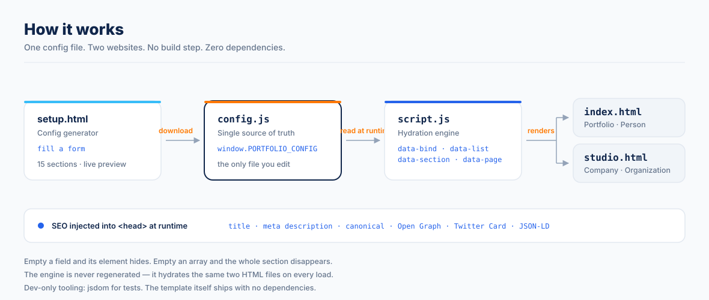

<div align="center">


<br/>

# ABMVSC Portfolio Engine

**A zero-dependency developer portfolio + company site, rendered entirely from one config file.**

[](https://abms-portfolio.netlify.app/)
[](https://abms-portfolio.netlify.app/studio.html)
[](https://abms-portfolio.netlify.app/setup.html)
[](LICENSE)
[](.)
[](.)

[](https://github.com/Balama2520/abmvsc-portfolio-template/actions/workflows/validate.yml)
[](CONTRIBUTING.md)
[](CODE_OF_CONDUCT.md)

</div>

---

## What Is This?

A complete, **zero-dependency** portfolio template engineered by [ABMVSC Technology & Innovation Studio](https://abms-portfolio.netlify.app/studio.html).

You edit **one file** — `config.js` — and both pages rebuild themselves: text, lists, images, links, colours, fonts, the AI chatbot, the SEO tags and the social preview cards. No framework, no bundler, no Node, no `npm install`. Pure HTML5 + CSS3 + vanilla JavaScript, MIT licensed, ready to drag onto Netlify.

| Page | Route | Purpose |
|---|---|---|
| **Personal Portfolio** | `/index.html` | Your skills, projects, experience, research and contact |
| **Studio / Company Page** | `/studio.html` | Your agency, studio or company identity |

Both pages share one config, one CSS system, one JS engine and one chatbot — fully connected.



---

## Features

- **Single source of truth** — `config.js` drives 100% of both pages. Nothing is hardcoded in the HTML.
- **Built-in config generator** — open `setup.html`, fill in a form, watch both sites preview live, and download a ready-made `config.js`. No coding required.
- **Graceful degradation** — delete a section, empty an array (`[]`), or blank a single field (`""`) and that part of the site hides itself cleanly. No broken layouts, no "undefined".
- **Ships both sites** — personal portfolio *and* company/studio page, cross-linked.
- **AI-style chatbot** — rule-based intent engine with streaming responses, telemetry badges, in-chat action buttons and dynamic quick-reply chips. Built from your config — no API key, no external service.
- **Automatic SEO** — page title, meta description, canonical URL, Open Graph, Twitter Card and JSON-LD structured data are injected into `<head>` at runtime. You never touch the HTML.
- **Runtime theming** — colours and fonts are CSS custom properties written from `config.theme`.
- **Zero dependencies** — no React, no Node, no build step.
- **Fully responsive** — mobile-first, tested down to 375px.
- **Resume modal** — built-in PDF preview, no third-party viewer.
- **Favicon + PWA package** — ICO, PNG 16/32, Apple Touch, Android Chrome 192/512, web manifest.
- **Deploy anywhere static** — Netlify, GitHub Pages, Cloudflare Pages, Vercel, S3.

---

## File Structure

```
your-portfolio/
│
├── config.js                    ← THE ONLY FILE YOU EDIT (your content)
│
├── index.html                   ← Personal portfolio page (layout only, no content)
├── studio.html                  ← Company / studio page (layout only, no content)
├── style.css                    ← Shared design system (CSS variables + components)
├── script.js                    ← Hydration engine, chrome, chatbot, SEO injection
│
├── setup.html                   ← Config generator — build your config.js in the browser
├── setup.css                    ← Generator styling (scoped, cannot leak into the site)
├── setup.js                     ← Generator logic
│
├── favicon.ico                  ← Browser tab icon
├── favicon-16x16.png
├── favicon-32x32.png
├── apple-touch-icon.png         ← iOS home screen icon
├── android-chrome-192x192.png   ← Android home screen icon
├── android-chrome-512x512.png
├── site.webmanifest             ← PWA manifest
│
├── og-image.png                 ← Social media preview card (1200×630)
├── resume.pdf                   ← Your resume (opens in the modal)
│
├── robots.txt                   ← Crawl rules — set your own domain
├── sitemap.xml                  ← Sitemap for both pages — set your own domain
│
├── netlify.toml                 ← Netlify config: security headers + caching
├── _headers                     ← Same headers for Cloudflare Pages
├── package.json                 ← Dev tooling only (test runner) — no dependencies ship
│
├── test/
│   ├── hydration.test.mjs       ← The engine's contract
│   └── guardrails.test.mjs      ← Zero-dependency / no-build-step promises
│
├── .github/
│   ├── workflows/validate.yml   ← CI: runs the test suite on every push
│   ├── ISSUE_TEMPLATE/          ← Bug + feature request forms
│   └── PULL_REQUEST_TEMPLATE.md
│
└── assets/
    ├── readme-architecture.svg  ← The diagram above
    ├── engineer-avatar.svg      ← Default profile avatar used by config.js
    ├── abmvsc-hero-banner.jpg   ← Studio page hero image
    ├── abmvsc-logo-card.jpg     ← Studio logo card
    └── logo/                    ← ABMVSC brand marks (swap these for your own)
```

---

## The Config Generator — no coding required

Not comfortable editing JavaScript? The template ships with a **built-in generator** at `setup.html`.

Open `setup.html` (from the live demo, or from your own copy), and you get:

- A **guided wizard** — the 15 sections are grouped into six chapters (You → Your work → Extras → Your company → Look & feel → Launch) and asked one at a time, with a step rail you can click to jump anywhere. Prefer the whole form at once? Hit **Show everything**.
- **Every field from `config.js`**, with help text and a count per section.
- A **live preview** of both `index.html` and `studio.html` side by side, updating as you type (plus a mobile-width toggle).
- A **completeness meter** showing how much you have filled in.
- **Download** or **Copy** buttons that produce a finished `config.js`.
- **Import** — point it at an existing `config.js` (including your own) to load and edit it.
- **Local draft saving** — your progress is kept in your browser. Nothing is uploaded anywhere.

**The workflow:**

```
1. Open setup.html
2. Answer the chapters (skip anything you don't have)
3. Watch both sites update in the live preview
4. Click "Download config.js"
5. Drop that file into your project folder, replacing the existing config.js
6. Deploy the folder — done
```

The final **Launch** chapter walks through steps 4–6 with copy-ready buttons for the repository URL and the `git clone` command, so you can go from an empty form to a live URL without leaving the page.

> The sample `config.js` ships with `theme.showDemoNotice: true`, which shows a floating "this is the demo" notice on both pages. Every config the generator produces sets it to `false`, so the notice disappears the moment your own file is in place.

> The generated file is a plain `config.js`. It is byte-for-byte the same format as the hand-written one, so you can always switch to editing it by hand later.

**Note:** the live preview fetches `index.html` / `studio.html`, so it needs a local server rather than a `file://` path:

```bash
npx serve .
# then open http://localhost:3000/setup.html
```

Everything else — the form, the download, the import and the copy button — works even without it.

---

## Quick Start

### Step 1 — Get the code

```bash
git clone https://github.com/Balama2520/abmvsc-portfolio-template.git
cd abmvsc-portfolio-template
```

Or download the ZIP and unzip it.

### Step 2 — Open it locally

Because everything renders from `config.js`, open the folder over a tiny local server (any static server works):

```bash
npx serve .
# or
python -m http.server 8080
```

Opening `index.html` directly from the file system also works in most browsers.

### Step 3 — Edit `config.js`

Prefer not to touch code? Skip straight to [the config generator](#the-config-generator--no-coding-required) — it writes this file for you.

Otherwise, open `config.js` and fill in the 15 sections:

| # | Section | Drives |
|---|---|---|
| 1 | `personal` | Navbar, hero, about, contact, footer, chatbot |
| 2 | `seo` | Page title, description, canonical, OG/Twitter cards, JSON-LD |
| 3 | `hero` | Hero eyebrow/badge/headline, stat row, marquee *(optional)* |
| 4 | `about` | About paragraphs, vision, reason cards *(optional)* |
| 5 | `skills` | Skills summary + category cards |
| 6 | `projects` | Project cards |
| 7 | `experience` | Work experience cards |
| 8 | `education` | Education entry |
| 9 | `research` | Publications *(optional)* |
| 10 | `achievements` | Awards and honours *(optional)* |
| 11 | `certifications` | Certifications *(optional)* |
| 12 | `company` | Everything on `studio.html` |
| 13 | `contact` | Extra contact links *(optional)* |
| 14 | `chatbot` | Assistant name, greeting, custom answers |
| 15 | `theme` | Brand colours and fonts *(optional)* |

Every section is optional. Leave a field as `""` and its element disappears. Leave an array empty and its whole block disappears.

### Step 4 — Add your media

| File | Replace with |
|---|---|
| `assets/engineer-avatar.svg` | Your own profile photo (point `personal.photo` at it) |
| `resume.pdf` | Your own resume (point `personal.resume` at it) |
| `og-image.png` | Your own 1200×630 social preview image |
| `favicon.*` + `android-chrome-*` | Your own icons (use [favicon.io](https://favicon.io)) |

### Step 5 — Deploy

**Netlify (recommended — free):**

1. Go to [app.netlify.com](https://app.netlify.com)
2. Click **Add new site → Deploy manually**
3. Drag your project folder onto the page
4. Done — live in seconds, no build step

**GitHub Pages:**

1. Push your code to a GitHub repository
2. Go to **Settings → Pages → Deploy from branch → main → / (root)**
3. Your site goes live at `https://yourusername.github.io/repo-name`

---

## How the Engine Works

`script.js` walks the DOM looking for four data attributes and fills them from your config.

| Attribute | Put it on | What it does |
|---|---|---|
| `data-bind="dotted.path"` | Any element | Writes the config value into the element's text. Blank value ⇒ the element hides itself. |
| `data-list="name"` | An empty container | Renders the matching list (projects, skills, certifications…). Empty list ⇒ the container hides. |
| `data-list-host` | A wrapper around a list | Tells the engine which element to hide when that list is empty (so a whole section isn't hidden by accident). |
| `data-section="key"` | A `<section>` or a nav link | Shows/hides the section — and its nav link — based on whether that content exists. |
| `data-page="portfolio" \| "studio"` | The `<html>` element | Tells the engine which page it is rendering. |

**Derived values.** Some bindings are computed rather than read straight from config. For example `hero.eyebrow` falls back to `personal.availability`, and `company.titleLine1` / `company.titleLine2` are split from `company.tagline` around its full stops. That's why you can leave `hero.eyebrow` blank and still get a sensible hero.

**SEO injection.** On load, the engine writes `<title>`, `<meta name="description">`, `<link rel="canonical">`, the Open Graph + Twitter Card tags and a JSON-LD block (`Person` on the portfolio, `Organization` on the studio page) into `<head>`. Both HTML files ship with an essentially empty `<head>` on purpose.

---

## Customisation Guide

### Colours & Fonts

Everything visual lives in `config.theme` — no CSS editing required:

```js
theme: {
  primaryColor: "#10264B",   // deep navy — headers, dark sections
  accentColor:  "#FF7900",   // orange — primary accents
  blueColor:    "#2563EB",   // blue — links and interactive states
  fontHeading:  "'Space Grotesk', 'Inter', sans-serif",
  fontBody:     "'Inter', -apple-system, sans-serif",
  fontMono:     "'IBM Plex Mono', monospace",

  showBuiltBy: true,         // false → removes the "Built with the ABMVSC
                             //          Portfolio Engine" footer credit
  showDemoNotice: true,      // false → hides the floating "this is the demo"
                             //          notice (the generator always writes false)
}
```

The engine writes these into CSS custom properties (`--navy`, `--orange`, `--blue`, `--font-heading`, `--font-body`, `--font-mono`) at runtime. Fonts are loaded from Google Fonts in both HTML files — swap that `<link>` if you change families.

### Chatbot Answers

The chatbot is fully driven by your config. `chatbot.customResponses` holds free-text answers you want to control directly:

```js
chatbot: {
  assistantName: "Alex's AI Assistant",
  greeting: "Hello! Ask me about my projects, skills or experience.",
  studioGreeting: "Welcome to the studio! Ask about our products or capabilities.",
  customResponses: {
    whyHire:  "I ship production systems, not demos. Here's why I'm a strong hire…",
    pricing:  "…",
    hobbies:  "…",
    fallback: "…",   // used when nothing matches
  },
}
```

Everything else — skills, projects, experience, education, research, achievements, contact, resume — is answered automatically from the corresponding config sections.

### Extending the Engine

To add a brand-new list, add a renderer and a count in `script.js`:

```js
// 1. in RENDERERS
"my-things": () => valueCards(myThings),

// 2. in LIST_COUNTS
"my-things": myThings.length,
```

Then drop `<div data-list="my-things"></div>` into either page. Sections are shown/hidden automatically once the list has a count.

---

## SEO Setup

### robots.txt

```
User-agent: *
Allow: /

Sitemap: https://your-domain.com/sitemap.xml
```

Replace `your-domain.com` with your own domain — the shipped value is a placeholder.

### sitemap.xml

Replace every `https://your-domain.com` with your domain. The file lists both pages:

```xml
<loc>https://your-domain.com/</loc>
<loc>https://your-domain.com/studio.html</loc>
```

`setup.html` is deliberately absent — it carries `noindex` and must never appear in a sitemap.

### Google Search Console

1. Go to [search.google.com/search-console](https://search.google.com/search-console)
2. Add your domain as a property
3. Choose **HTML tag** verification
4. Paste the token into `seo.googleVerification` in `config.js` — the engine writes the
   `<meta name="google-site-verification">` tag for you, so no extra file is needed
5. Submit `sitemap.xml` after verification

Also set `seo.siteUrl` in `config.js` — that's what the canonical URL and social tags are built from.

---

## Browser Support

| Browser | Support |
|---|---|
| Chrome 90+ | ✅ Full |
| Firefox 88+ | ✅ Full |
| Safari 14+ | ✅ Full |
| Edge 90+ | ✅ Full |
| Mobile Chrome / Safari | ✅ Full |

Requires `IntersectionObserver`, `CSS custom properties` and ES6 — all universally available in the versions above. No polyfills needed.

---

## Testing

The engine has a regression suite that runs headlessly with [jsdom](https://github.com/jsdom/jsdom).
It exists so nobody can silently break a user's site — most importantly it round-trips
`config.js` through the generator and fails if a single value would be lost.

```bash
npm install    # dev tooling only — the template itself still has zero dependencies
npm test
```

```
✔ guardrail: the template has no runtime dependencies
✔ guardrail: the template has no build step
✔ guardrail: every JavaScript file parses
✔ guardrail: the pages load no third-party JavaScript
✔ guardrail: every file referenced by the HTML exists
✔ guardrail: the generator stays out of search results
✔ guardrail: the licence is MIT and attributed
✔ config.js defines all 15 documented sections
✔ the optional reference config parses too
✔ browsing pages are content-free (content lives in config.js)
✔ setup.html is excluded from search engines
✔ the generator renders every section
✔ the generator round-trips config.js with zero data loss
✔ array-shaped sections keep their shape through the generator
✔ index.html hydrates from config.js
✔ studio.html hydrates from config.js
✔ both pages inject SEO tags from config, not from HTML
✔ every data-list in the HTML is registered in the engine
```

18 tests, no network access required — the suite serves the repo from a local
port and blocks every non-local request, so it passes offline and in CI alike.

**The guardrails are the point.** They fail the build if anyone adds a runtime
dependency, adds a build step, pulls in third-party JavaScript, or points a tag at
a file that does not exist. The promises in the badges above are enforced, not just
advertised.

`npm install` is only for the test runner. **Deploying the site never requires it.**

---

## Licence

Released under the **MIT Licence**.
Free to use, modify and distribute for personal and commercial projects. Attribution to ABMVSC is appreciated but not required.

See [LICENSE](LICENSE) for full terms.

---

## Built By

<div align="center">

**ABMVSC Technology & Innovation Studio**

*Engineering Ideas. Empowering Tomorrow.*

`BUILD · RESEARCH · INNOVATE · SCALE · IMPACT`

[Studio](https://abms-portfolio.netlify.app/studio.html) · [GitHub](https://github.com/Balama2520) · [Contact](mailto:contact@abmvsc.studio)

</div>
